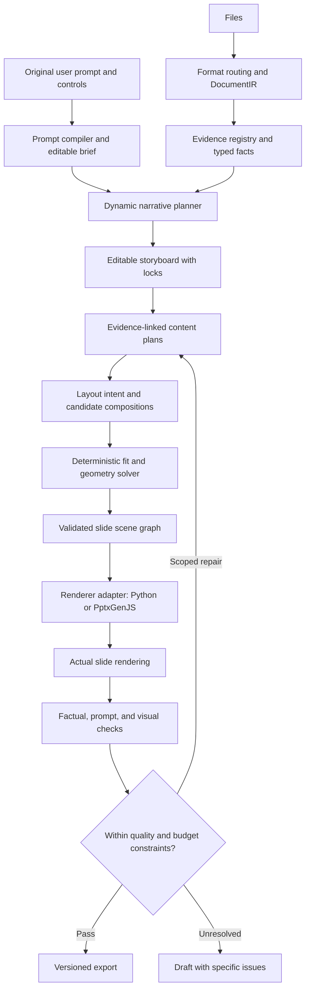

# PPTAI implementation plan

Prepared on 8 October 2026 from the repository, branch comparison, live execution, automated checks, and rendered slide inspection.

**Recommendation:** retain `multi-agent` as the development base and adapt the useful PptxGenJS renderer from `origin/hardik-pptxgenjs`. Build a shared pipeline that compiles the user's prompt into an editable brief, plans a source-grounded narrative, composes evidence-linked content, and generates each slide through a constrained layout grammar. Support bento grids, asymmetric compositions, timelines, comparison slides, and figure-led layouts with deterministic geometry and actual PowerPoint rendering checks. Give agents typed tools for retrieval, calculations, layout measurement, and validation. Evaluate user intent, factual correctness, visual design, and efficiency separately.

This revision incorporates the requested dynamic prompt enhancement, dynamic deck flow, dynamic per-slide layouts, agent tools, academic/showcase evaluation, and the newly fetched branch. Sections 4–6 specify the architecture, contracts, and delivery sequence.

## 1. What was inspected and run

The Git repository is `C:\Users\thang\Projects\PPTAI\BTPs5`, inside the workspace. Remote branches were fetched and inspected without switching or modifying the checkout.

| Branch | Commit | Assessment |
|---|---|---|
| `main` | `bba4c39` | Older alternative multi-agent architecture, topic mode, graph scaffolding, and visual critic. Useful concepts, but contains truncated extraction, weak validation, double throttling, and invented topic-mode fallback statistics. Avoid merging this branch wholesale. |
| `evalute-pipeline` | `abd5281` | Legacy generation plus the evaluator. Its five tests passed in an isolated snapshot. Its evaluator is already inherited by `multi-agent`. |
| `multi-agent` | `24e8a3a` | Best foundation: strict intermediate models, scoped composition, stable knowledge IDs, stage artifacts, resume, editing, native charts/diagrams, and an explicit visual-audit status. Its tests produced 13 passes and one failure. The CLI still defaults to legacy generation. |
| `origin/hardik-pptxgenjs` | `f9a50e4` | Newly fetched independent history with a PptxGenJS 3.12 renderer. Direct compilation succeeds, but table output fails to open in PowerPoint until the vertical-alignment option is corrected. The CLI still invokes Python; images/diagrams are placeholders; geometry remains tied to the fixed catalog. Adapt its renderer through the current pipeline rather than adopting its older stages. |

Execution evidence:

1. Ran the current CLI against the supplied Attention Is All You Need PDF with the multi-agent pipeline, technical lens, 6–8 slides, and polish enabled. Parsing completed with **127 text blocks, four tables, and three images**. The LLM stage then failed with **OpenRouter HTTP 402**. The request reserved 8,192 output tokens; the server reported an affordable maximum of 3,994. The client treats 402 as transient and repeatedly retries it.
2. Ran the current legacy semantic stage using the newly extracted IR. Gemini returned repeated **503 UNAVAILABLE** responses and the bounded retry sequence ended in failure.
3. Ran `python -m pytest` on the current branch using a fresh workspace temporary directory: **13 passed, one failed**. The failure is `test_llm_client_sends_openrouter_schema_request_without_network`: the request lacks `provider.require_parameters`. The initial test invocation also encountered permissions on existing Windows temporary/cache directories; relocating those directories separated the environment problem from the application failure.
4. Started both other branches' CLIs with `--help` in isolated source snapshots. Ran the evaluator branch's tests: **five passed**. An initial snapshot omitted a reporting file; after correcting the snapshot, the branch tests passed. That initial error is not a repository defect.
5. Rendered all nine slides of the existing output using PowerPoint COM and inspected them. Recompiled the existing content JSON with the current builder, which returned no warnings, rendered the result, and inspected representative slides. The current deterministic gate marked this deck **PASSED**, despite small-font warnings.
6. Re-ran the existing deck evaluator with AI judging disabled: overall **0.802**, weighted coverage **0.893**, visual **0.778**, using **TF-IDF fallback**. The reference contains only **five concepts**. The stored earlier report also scored approximately 0.802, even though faithfulness had failed due to Gemini quota exhaustion.
7. Tested a Markdown document containing a table and an equation. The current wrapper successfully extracted three text blocks and a table. The equation became ordinary text; no formula asset was created. The wrapper already accepts some non-PDF formats through Docling defaults, despite PDF-only CLI wording.
8. Installed the new branch's locked Node dependencies in its isolated snapshot and compiled all nine existing slides with its JavaScript renderer. ZIP/XML inspection and python-pptx parsing passed, but PowerPoint could not open the deck. Minimal, two-slide, and seven-slide/no-table controls opened. A runtime-only change from table `valign: "mid"` to `"middle"` produced a nine-slide deck that PowerPoint opened and rendered. The actual branch source was left unchanged. The resulting slide images still show image placeholders and overly tall table rows.

**Limits of this audit:** no fresh, fully LLM-generated deck completed because the two configured providers failed. Visual findings concern the existing deck and its recompilation. The other branches were inspected and smoke-tested; the new JavaScript renderer was also exercised with existing content and actual PowerPoint. These are controlled renderer probes, not fresh end-to-end generation benchmarks. One supplied paper is insufficient to estimate general quality or latency.

Application source files and the original output were left unchanged. Audit scripts, branch snapshots, rendered slides, and logs are in `C:\Users\thang\Projects\PPTAI\audit-artifacts`.

## 2. Findings that should drive the implementation

| Priority | Finding and evidence | Concrete change |
|---|---|---|
| P0 | The new JavaScript renderer emits table-cell `anchor="mid"`; PowerPoint rejects the deck. An isolated `valign: "middle"` correction fixes opening/rendering. `hardik-pptxgenjs/core/builder.js:518`. | Correct the option, validate emitted OOXML enum values, and add a native PowerPoint open/render integration check. ZIP validity alone is insufficient. |
| P0 | Billing errors retry; every OpenRouter request reserves 8,192 output tokens. Observed 402 failure. `core/llm_client.py:119,168,239`. | Classify permanent and transient errors from status and error code. Fail promptly on insufficient credits. Configure output budgets by stage and batch size. Record failed attempts and terminal run status. |
| P0 | Required OpenRouter provider flag is absent; one existing test fails. `core/llm_client.py:178`, `tests/test_multi_agent_contracts.py:94`. | Restore `require_parameters: true`, retain compatible-provider fallbacks, and validate the actual schemas against the selected endpoint. Keep local Pydantic validation. |
| P0 | Numeric grounding verifies number presence, not the relationship. Probe accepted “Profit was 10 million” against “Revenue was 10 million. Profit was 2 million.” `pipeline/knowledge_extractor.py:194`. | Represent metrics with subject, value, unit, period, and table/block evidence. Validate bindings, comparisons, and calculations. Label regex checks as partial validation; stop assigning factual confidence 1.0 after these checks alone. |
| P0 | Two text boxes at identical coordinates produce zero suspicious overlaps. The visual check excludes nearly all pairs of text-bearing shapes because its width condition is effectively always true. `evalute/metrics/visual.py:21`. | Replace the width exception with explicit containment/background relationships. Check visible text and image intersections. Add a regression case for fully overlapping boxes and a separate case for intentional background containment. |
| P0 | An image with ID `does-not-exist.png` passes slide-spec validation. Formula validation also checks only that an ID exists as a string. `pipeline/slide_composer.py:28`. | Validate every asset ID against the retrieved asset registry, its kind, actual file, and allowed source. Reject missing assets before compilation. Distinguish optional illustration omission from missing required evidence. |
| P0 | Sparse section merging can lose the merged section's asset links. Reproduced with an image in section B merged into section A. The merge also does not recheck the token cap. `pipeline/chunker.py:49`. | Merge unit IDs, section IDs, and asset IDs together; recheck the token budget. Assert every selected unit and asset remains retrievable. |
| P0 | Visual repair writes new JSON before the repaired deck passes, then checks only deterministic geometry. It does not rerender/re-audit the repaired deck. The manifest can report PASSED with an earlier FAILED visual audit. `pipeline/orchestrator.py:211`. | Stage all artifacts in a new revision, rerender and run factual plus visual checks, then publish the revision atomically. Store the final audit against the final deck hash. Honor the configured repair limit. |
| P1 | Font sizes shrink by character/item counts. Tables shrink to 10–11 pt. Existing slides contain 11–12 pt table cells and 9–10 pt captions. `core/builder.py:372,767`. | Measure text within actual regions. Apply layout-specific font floors. Shorten, switch layouts, split, or use notes before reducing below the floor. |
| P1 | Table rows fill the entire region regardless of content. A five-row table occupies 4.65 inches vertically. | Compute table height from row content and padding. Use fewer relevant rows/columns on the main slide, preserve the complete table in an appendix, and render eligible numeric comparisons as native charts. |
| P1 | All seven extracted assets lack source references; all three images lack captions. The parser reads `caption`, whereas installed Docling exposes `captions` and `caption_text(doc)`. `pipeline/stage1_docling_parser.py`, `pipeline/source_adapter.py:83`. | Preserve item IDs, page/bounding-box provenance, caption refs, hierarchical sections, and linked paragraph refs. Use `caption_text(doc)`, `get_image(doc)`, and `export_to_dataframe(doc)`. |
| P1 | Tables are separate files but lack citable source blocks. Extraction requests exact text-block evidence, so table-only facts cannot be grounded consistently. | Introduce evidence variants for blocks, table cells, figures, and formulas. Make table values deterministically available as typed facts. |
| P1 | Table fallback uses global asset directories instead of the active run's registry and expects an object while extraction writes a list of records. It silently catches loading errors. `core/builder.py:745`. | Standardize `{headers, rows, cells, source_refs}` and resolve assets from the run registry. Report malformed or missing required tables as compilation failures. |
| P1 | The layout catalog exposes names, regions, and allowed types, but no region capacities, aspect ratios, or density limits. `pipeline/storyboard_planner.py:24`. | Add semantic purpose, required regions, text budgets, image ratios, table/chart limits, and compatible slide purposes. Restrict each composer to a small suitable candidate set. |
| P1 | Initial generation has no general user brief. `--instruction` applies only to editing. OpenRouter sends everything as one user message. | Add a typed PresentationBrief and separate stage system instructions, user preferences, and untrusted source data. |
| P1 | The paper produces 25 sequential knowledge-extraction requests, including a References section and nearly empty headings. | Pack nearby substantive sections into bounded batches while retaining their identities. Treat bibliographic material as citation support unless requested in the presentation. Cache each batch as it completes. |
| P1 | The reference is generated from the same semantic extraction as the slides, so shared omissions can receive high coverage. Only concepts are evaluated; metrics, equations, tables, and figures are omitted. | Use an independently reviewed reference containing required facts and assets, conditioned on the brief. Evaluate each evidence type. |
| P1 | The evaluator omits table-cell font sizes, full chart data, grouped shapes, and image content. It cleans line breaks before claim extraction. | Recursively extract objects and preserve text hierarchy, list items, chart data, cell styles, and source claims. Add rendered-slide inspection for content invisible to native extraction. |
| P1 | Semantic scoring silently changes to TF-IDF while retaining embedding thresholds. Failed/skipped faithfulness is removed and the remaining weights are renormalized. | Require a named benchmark backend; calibrate thresholds separately. Report incomplete evaluation explicitly. Show available scores with completeness instead of presenting a comparable all-metrics score. |
| P2 | CLI resume still reruns Docling. Successful knowledge batches and completed slides are persisted only after their entire stage finishes. | Cache parsing by source hash/options/version, batches by evidence/prompt/schema/model hashes, and individual slides by plan/context/theme hashes. |
| P2 | Several rendering implementations and layout catalogs exist. Requirements are unpinned and evaluator dependencies are installed separately despite eager imports. | Use one validated scene-graph contract and renderer interface. Adapt Python and PptxGenJS behind it, compare parity, and select one default after testing. Make entry scripts wrappers. Consolidate themes/layout grammar, declare optional extras, and add lockfiles plus clean-install checks. |

The `main` branch has additional regressions already discussed in the existing merge-plan documents: truncation to the first six sections/25 blocks, numeric validation over only the first 100 blocks, graph arguments that do not drive retrieval, double rate limiting, and fabricated `3.5x`/`42%` topic-mode fallback claims. Retain its useful feature ideas only after rebuilding them on the current contracts.

## 3. Changes that directly improve slide quality

Start with one consistent theme and a tested composition grammar. Its primitives are grid, row, column, stack, text, figure, chart, table, formula, and diagram. Keep cover, concise explanation, figure-led, chart-led, comparison, process, equation, and conclusion recipes as reliable starting candidates and fallback compositions. The designer can combine these primitives dynamically, including bento grids with variable spans and cell counts. Section 5.4 specifies the solver and constraints. Variation should follow the slide's purpose and evidence while the typography, colors, and spacing stay coherent across the deck.

Define a `ThemeSpec` with fonts, colors, background, accent, spacing, margins, chart palette, and table styles. A professional template should supply consistent masters and design tokens; the LLM should select content and composition intent. Arbitrary LLM style dictionaries should be restricted to permitted overrides.

Suggested starting defaults, to tune through real rendered examples:

| Element | Default | Fit rule |
|---|---|---|
| Cover title | 44–56 pt | Minimal title and subtitle; at most two title lines. |
| Slide title | 32–36 pt | Prefer one line; shorten or allocate two lines explicitly. |
| Main prose | 20–24 pt, floor 18 pt | Usually 2–4 short points and 35–60 words, depending on layout. |
| Table cells | 16–18 pt | Main slides normally show at most six data rows and five columns; split or use an appendix when evidence requires more. |
| Figure captions / metric labels | 16–18 pt | Size and place them inside a reserved caption region. |
| Source footer | 12–14 pt | Treat as a distinct role, not body text. |

These are product defaults, not universal rules. User templates can define different values. Budget text per region and compare the actual rendered bounds with its permitted bounds. `TextFrame.fit_text()` can assist measurement, but blindly fitting everything by shrinking will recreate the current problem. Its behavior is documented in the [python-pptx text-fit documentation](https://python-pptx.readthedocs.io/en/latest/dev/analysis/txt-fit-text.html).

For the inspected deck, make these first changes:

- Slide 2: use a restrained metric row with substantially shorter labels. Reduce the tall decorative card treatment and make labels readable.
- Slide 3: enlarge the relevant portion of the architecture figure; shorten the explanation to the most important supported points. Put implementation details into speaker notes.
- Slide 4: display the attention equation as a proper equation asset. Use the correctly linked figure caption. Split scaled attention and multi-head attention when the requested count permits.
- Slide 5: give the comparison table compact content-based row heights, proper math typography, and one visible takeaway.
- Slide 6: separate positional encoding from feed-forward layers, or keep one as supporting detail in notes. Each slide should have one principal purpose.
- Slide 7: show an editable comparison chart for the relevant benchmark and keep the full evidence table in an appendix. Avoid mixing English–German and English–French results into a single superiority claim. The shown Transformer big score of 41.0 does not exceed the displayed ensemble scores of 41.16 and 41.29 in English–French.
- Slide 8: compress training settings into a readable, logically grouped explanation. Define symbols or put the exact configuration in notes.
- Slide 9: give a concrete supported conclusion and its limits instead of a broad promotional summary.

## 4. Target pipeline and contracts



Extend the existing contracts. Every contract needs a schema version; stable IDs must survive edits and revisions. The names below describe the target contracts; some are new modules.

| Contract | Required responsibilities |
|---|---|
| `DocumentIR` | Document/source hashes, parser version/options, hierarchical sections, text/table/formula/figure blocks, and asset registry. Namespace IDs by document so multiple uploads cannot collide. |
| `EvidenceRef` | Discriminated references to text excerpts, table cells/ranges, figure/page regions, and formulas. Preserve unit, date/period, precision, caption, and original text. |
| `KnowledgeUnit` | Stable IDs, priorities, typed metrics/comparisons/limitations, evidence links, and validation state. Separate exact evidence existence, numeric binding checks, and semantic entailment. |
| `PresentationBrief` | Original/enhanced prompt; audience, objective, duration, count/range, language, topic inclusions/exclusions, density, narrative/design preferences, notes, theme, source policy, hard/soft constraints, and user locks. Record whether each field came from the user or an inferred default. |
| `NarrativePlan` | Ordered slide purposes, section boundaries, prerequisite relationships, evidence coverage, transitions, estimated speaking time, and count allocation. Cover/ending/appendix count semantics must be explicit. |
| `ContentPlan` | Title intent, atomic claims, supporting evidence, required/optional content, visual data/asset IDs, and speaker notes. No coordinates. Unsupported material must not become a fact merely by acquiring a source ID. |
| `LayoutIntent` | Candidate composition, semantic regions, grid spans/order, hierarchy, alignment, and fit preferences. Uses content/object IDs and theme tokens; the model does not choose unrestricted drawing commands. |
| `SlideSceneGraph` | Resolved native objects with stable IDs, inch geometry, text roles/runs, source links, data bindings, asset references, intended containment/z-order, and theme version. A discriminated object union replaces arbitrary style dictionaries. |
| `RunManifest` | Source/brief/prompt/schema/model hashes, stage statuses/timings, attempts/failures, token/cost observations, cache hits, final artifact hashes, audit completeness, and terminal state. Creation success, factual readiness, and visual readiness are separate. |

Use a shared JSON Schema for the Python service and TypeScript renderer; generate or verify both languages' validators against it. Rendering receives data-only scene graphs and resolved assets. Keep model-authored executable code outside the rendering contract.

### Incorporating `hardik-pptxgenjs`

The new branch has no common Git ancestor with the current branch. Port the relevant implementation as a module with attribution/history recorded; a wholesale merge would introduce a second older generation pipeline.

1. Move the useful builder behind `renderers/pptxgenjs/` and expose `render(scene_graph, asset_registry, output_path)`. Add `--renderer python|pptxgenjs` to the current CLI/service. Keep Python available while verifying parity.
2. Correct table vertical alignment. Replace image/diagram placeholders with resolved native assets/objects; add formula assets. Validate chart-series lengths, category bindings, negative axes, and horizontal-bar direction. Unsupported required objects must fail preflight instead of silently being skipped.
3. Decouple drawing from `config/ppt_default_layouts.json`. The solver supplies computed boxes; recipes become layout proposals, not renderer-owned fixed coordinates. Centralize theme and text roles.
4. Remove unconditional `fit: "shrink"` as the main fit policy. Compute text/table sizes before export; verify actual rendering afterward. The branch currently forces 5–7 bullets and 90–140 words for nonvisual slides; replace this with content budgets derived from the brief, purpose, and measured region capacity.
5. Retain the current orchestrator, evidence contracts, cache, and evaluation. The branch's `main.py` still imports the Python builder, ignores the layout argument when constructing it, and its planner writes under global `output/`; fix these through the shared service rather than copying the older stages.
6. First establish a passing integration baseline with the locked dependency. Evaluate a supported PptxGenJS upgrade in a separate change, with the same scene graphs and render comparisons.

PptxGenJS documents native table formatting/content-dependent row sizing and image/SVG support. SVG compatibility depends on the PowerPoint version, so keep a PNG fallback for mathematical assets. These capabilities make it a useful renderer candidate; the prompt compiler, narrative planner, and layout solver still supply the intelligence. See [tables](https://gitbrent.github.io/PptxGenJS/docs/api-tables.html) and [images](https://gitbrent.github.io/PptxGenJS/docs/api-images/).

## 5. Implementing the requested capabilities

### 5.1 More input formats, tables, LaTeX, and images

Keep Docling initially. The installed version is 2.121.0; its converter already supports a broad input enum, and the Markdown smoke test passed. Product support should mean a tested and documented extraction contract for each format, rather than simply accepting its extension. Docling documents [supported formats](https://docling-project.github.io/docling/usage/supported_formats/) and [optional formula/picture enrichment](https://docling-project.github.io/docling/usage/enrichments/).

Implement `pipeline/ingestion/router.py` and format-specific adapters. Prioritize PDF, DOCX, Markdown, HTML, TXT, CSV, XLSX, PNG/JPEG, and basic `.tex`. Preserve the Office-native table cells and figures whenever possible. For multiple files, retain source names and document IDs through every stage.

For PDF, measure text availability and document structure before selecting OCR/enrichment options. Use OCR for pages that need it and Docling's structure pipeline for complex layouts. Investigate a faster digital-text route only after comparing its tables, reading order, figures, and equations against the rich parser. Do not assume turning OCR off eliminates every expensive layout stage.

For tables, store typed cells, multi-row headers, merged spans, footnotes, unit labels, page, caption, and cell provenance. Preserve raw display values alongside normalized numeric values. Native charts must use deterministically selected or calculated values from those cells; the LLM selects the comparison, not invented chart values.

For figures, use Docling's real caption/image APIs and preserve linked caption refs. Record dimensions and intended display resolution. Use crop-based source images when appropriate, and reject enlargements that make essential labels unreadable. Describe only selected ambiguous figures with a VLM. Preserve the distinction between extracted evidence and any optional generated illustration.

For equations, retain original LaTeX plus source location. Enable formula enrichment where needed and support a source-image crop fallback. Render supported math into a high-quality asset, cache it by expression/style hash, and place it with a brief explanation. MathJax supports [self-contained SVG math output](https://docs.mathjax.org/en/latest/output/svg.html); rasterize that output to a transparent, high-resolution PNG for the current python-pptx path. Keep LaTeX and provenance in the artifact/notes. Native editable Office equations can be a later, separately verified feature. Do not render raw `sqrt`, caret, and underscore strings as the final equation treatment.

**Acceptance:** each supported format has a fixture and explicit support limits; key text survives, selected assets have usable provenance, table numbers/units are preserved, and equation fixtures produce readable math or an explicit unsupported state.

### 5.2 Dynamic user prompts, enhancement, and system integration

Implement a prompt compiler in `pipeline/prompt_enhancer.py`, with a typed `PresentationBrief` in `schemas/brief_schema.py`. It turns a free-form request into an explicit, editable generation specification.

1. Extract explicit requirements first: exact/ranged count, audience, objective, duration, must-include/excluded topics, theme, preferred visual forms, language, notes, and locked elements. Preserve precise numbers and quoted wording. Use deterministic UI-field overrides for structured controls.
2. Fill genuinely unspecified fields with recorded defaults. Return `original_prompt`, `enhanced_prompt`, the structured brief, inferred assumptions, and any conflicts. Enhancement can clarify presentation instructions; it must not add unsupported source claims or silently broaden the task.
3. Show the enhanced version and editable controls in the UI. Let the user revise either prompt, accept individual suggestions, or generate immediately using the displayed defaults. Avoid a mandatory confirmation step for every normal run. Save the exact version used.
4. Reconcile conflicts before expensive stages: for example, six slides containing ten required detailed comparisons at a fixed large font may not fit. Return concrete choices such as shorter summaries, notes, or an expanded count. Treat exact count and user locks as hard constraints unless the user changes them.
5. Cache extraction independently of the brief. Audience, order, density, or bento preference changes should replan/recompose only the affected stages. Preserve locked slides/objects and identify dependencies that make an edit infeasible.

Example original request: “Make 8 slides explaining this paper to undergraduate students in 10 minutes. Use a bento overview, explain the equations, and keep training details in notes.”

Example enhanced instruction: “Create exactly 8 slides, including the cover and conclusion, for undergraduate CS students. Build a 10-minute explanation with the necessary prerequisites before the main mechanism. Use a bento overview where it helps group the key ideas; show readable equations with symbol explanations. Use only supported paper claims and chart values. Put detailed training configuration in speaker notes. Keep one primary purpose per slide.” The inferred count convention must be visible and editable.

```json
{
  "audience": "undergraduate CS students",
  "objective": "explain the Transformer mechanism and evidence",
  "duration_minutes": 10,
  "count": {"mode": "exact", "value": 8, "includes_appendix": true},
  "language": "en",
  "theme_id": "academic_light",
  "narrative_preference": "prerequisites_then_mechanism_then_evidence",
  "design": {"preferred_compositions": ["bento_overview", "figure_led"], "density": "low"},
  "must_include": ["attention equation", "architecture", "benchmark comparison"],
  "notes_policy": "put detailed training settings in notes",
  "source_policy": "uploaded_sources_only",
  "locks": [],
  "constraints": [
    {"key": "count", "strength": "hard", "origin": "user"},
    {"key": "bento_overview", "strength": "soft", "origin": "user"},
    {"key": "count.includes_appendix", "strength": "hard", "origin": "default"}
  ]
}
```

Move stage instructions into versioned files under `prompts/`. Change `LLMClient.generate_structured` to accept `system_prompt` and a typed `user_payload`. Use strict schemas with compatible provider routing as documented in [OpenRouter structured outputs](https://openrouter.ai/docs/guides/features/structured-outputs); keep local validation. Send separate OpenRouter system/user messages; use Gemini's `system_instruction` for stage instructions and `contents` for the request/data. The system prompt defines the role, grounded evidence rules, permitted tools, and output schema. The user payload contains the brief, stage task, selected evidence, and permitted context. Source passages are untrusted data. User preferences can change emphasis, order, style, and granularity while the factual contract remains enforceable.

Add CLI `--prompt`/`--prompt-file` and `--brief` inputs for initial generation, rather than limiting `--instruction` to editing. Hash actual prompt contents and compiled brief into cache keys. Keep source-only generation as the default; external research is a separate user-controlled capability whose facts need their own provenance.

**Acceptance:** explicit counts/requirements survive enhancement; assumptions are visible; the same source yields different audience-appropriate flows; a bento request influences suitable slides; document instructions cannot override stage rules; changing one brief field invalidates only dependent work.

### 5.3 Multi-agent improvements

Use scoped roles for brief interpretation, evidence extraction, narrative planning, content composition, layout proposal, and critique. These are responsibilities, not a requirement to make six model calls for every slide. Structured briefs can bypass model interpretation; simple slides can use a deterministic composition; table/metric extraction and geometry should use code. The current architecture can support tool calls and role-specific schemas without introducing another agent framework. Section 5.7 defines the tools.

Implement dynamic deck flow in `pipeline/storyboard_planner.py`:

- Build a relevance/importance map conditioned on the brief, then identify prerequisites, explanation, mechanism, evidence, limitations, and ending roles as appropriate to the task. A business decision deck can use recommendation → evidence → tradeoffs → action; an introductory technical deck can use context → prerequisites → mechanism → evidence → limits. Paper section order is available evidence, not a universal deck template.
- Return a `NarrativePlan` with one primary purpose per slide, evidence IDs, expected speaking time, required/optional content, transitions, and dependencies. Allocate exact counts across cover, core story, ending, and appendix before composing slides. Validate must-include coverage and prerequisites deterministically where defined.
- Generate one plan by default. Offer a second narrative alternative on request, rather than paying for several unused plans every run. Users can reorder, split, merge, add, remove, or lock slides; recompute count/time/coverage and replan only unlocked dependent slides.
- For the supplied paper, an illustrative eight-slide teaching flow is: context/problem → attention intuition → attention equation → architecture → positional information → computational tradeoffs → a precisely scoped benchmark comparison → conclusion/limits. A cover can share the context slide if permitted; if a separate cover is required, rebudget the plan. Training settings can go into notes. This is a proposed brief-conditioned flow, not the only valid outline.

Improve orchestration and tool usage:

1. Batch small nearby sections up to a measured input/output budget while preserving each section and evidence ID. Bibliographies should remain available for citations without forcing a slide-worthy knowledge unit per section.
2. Validate rejected units individually. Today one accepted unit makes a section “covered,” so other rejected or omitted facts in that section do not trigger a retry. Track important fact/asset coverage explicitly.
3. Persist successful batches and slides immediately. Resume only failed work. Include prompt contents, schema, source/asset hashes, provider, and model in cache keys rather than relying on manual version strings alone.
4. Use one quota-aware gateway with request/token limits, concurrency, deadlines, retry-after handling, and a total run budget. Do not sleep while holding the limiter's global lock. Respect actual provider quotas.
5. Route by task complexity using a measured benchmark: extraction/composition can use economical models; planning and difficult factual/visual decisions can escalate. Configure model IDs per stage instead of retaining hardcoded legacy/evaluator models.
6. Apply bounded scoped repair using the current slide and actionable feedback. Revalidate its claims and assets, rerender it, and evaluate the final revision. Do not repair already approved slides unless their context changes.
7. Make editing transactional. An edit must update the manifest and slide cache entry so a later `--resume` cannot silently restore an older slide. Preserve revisions for undo.

For the supplied paper, the current first pass uses 25 extraction calls. An eight-slide deck with one planning call and two visual-audit batches would use 36 successful calls before repairs. At five starts per minute, the limiter alone spans at least about seven minutes for those starts, before accounting for the sequential stage boundaries and call latency. This is a call-count estimate, not a completed-run timing. Aim to reduce unnecessary extraction calls while retaining evidence, then measure total time and cost.

**Acceptance:** a failure on one slide/batch does not force successful items to rerun; repeated resume makes zero generation calls for unchanged inputs; edits survive resume; merged chunks retain assets; permanent provider failures stop promptly.

### 5.4 Dynamic slide layouts and concrete PPT generation

Separate **what the slide says** from **how the slide is arranged**. The composer writes a grounded `ContentPlan`; a designer proposes `LayoutIntent`; a deterministic engine resolves the final `SlideSceneGraph`.

Implement `core/layout_engine.py`, `core/text_measurement.py`, `schemas/layout_intent_schema.py`, and `schemas/scene_schema.py`. The TypeScript renderer consumes the scene graph rather than duplicating layout decisions.

1. **Select compositions from meaning.** A large source figure favors a figure-led composition; a metric comparison favors a chart; multiple related ideas can use a bento overview; ordered stages use a timeline/process. Treat bento as one useful option. Do not force an equation or detailed table into tiny cells simply to create visual variety.
2. **Propose bounded dynamic structure.** Use a 12-column grid with row spans, plus row/column/stack containers. Permit a small set of theme-controlled variants and normally 2–5 principal bento cells. Cell counts, spans, aspect ratios, and hierarchy vary with content. Cap nesting and candidate count, initially at three candidates per difficult slide; simple slides use one.
3. **Measure before positioning.** Load the actual font files, measure line wrapping/text height with padding and line spacing, derive table row/column dimensions from contents, and inspect image aspect ratio/resolution. Keep font roles consistent. Treat these measurements as estimates until verified by the supported PowerPoint renderer.
4. **Solve geometry in code.** Reserve title/footer margins; resolve grid spans into boxes; enforce minimum widths/heights, non-overlap except declared containment, aspect-fit constraints, and font floors. A first version can enumerate bounded candidates and solve rows/columns analytically. Use a constraint solver only if more complex reflow demonstrably needs one.
5. **Rank feasible candidates.** Optimize hierarchy, legibility, alignment, evidence visibility, balanced whitespace, and the user's style preference. Penalize repetitive compositions across adjacent slides without requiring a different style on every slide. Hard constraint failures disqualify a candidate; aesthetics cannot compensate for clipped evidence.
6. **Handle overflow explicitly.** Try a different composition or a shorter supported phrasing; move optional details to notes; split only when the brief permits count changes. If an exact count/locked design makes fit impossible, return the conflicting objects and available choices. Avoid silently shrinking fonts or omitting required facts.
7. **Compile native editable objects.** Text stays text, tables stay tables, chart values stay bound to source-backed data, and supported diagrams use shapes/connectors. Figures and equations use registered assets; retain math source and evidence in metadata/notes. Record the intended container/child relationships for overlap checks.
8. **Render and repair the actual file.** Compare rendered slides with scene geometry and intended roles; inspect clipped text, image labels, equations, chart axes, and table legibility. Make bounded object/slide patches, recheck factual bindings, and rerender the final revision. UI previews should come from this artifact; an HTML preview alone cannot establish PowerPoint fit.

Example layout proposal below uses symbolic IDs from an already validated content/evidence plan. Zero-based grid indices and positive spans are validated; coordinates are computed afterward. It illustrates an architecture figure beside two compact explanations, with a bottom takeaway. The lower-right cell is intentionally empty.

```json
{
  "slide_id": "s04",
  "composition": "bento",
  "grid": {"columns": 12, "rows": 3, "gap_token": "space_3"},
  "title_content_id": "s04_title",
  "cells": [
    {"id": "architecture", "col": 0, "row": 0, "col_span": 7, "row_span": 2,
     "content_ids": ["figure_architecture", "figure_caption"], "role": "hero"},
    {"id": "encoder", "col": 7, "row": 0, "col_span": 5, "row_span": 1,
     "content_ids": ["claim_encoder"], "role": "support"},
    {"id": "decoder", "col": 7, "row": 1, "col_span": 5, "row_span": 1,
     "content_ids": ["claim_decoder"], "role": "support"},
    {"id": "takeaway", "col": 0, "row": 2, "col_span": 9, "row_span": 1,
     "content_ids": ["claim_takeaway"], "role": "takeaway"}
  ],
  "constraints": {"preserve_figure_aspect": true, "allow_slide_split": false}
}
```

Each content ID resolves to a validated object with its own evidence links. A visually attractive layout is rejected if the figure becomes unreadable or the explanations exceed their cells. Do not have the LLM generate unrestricted JSX, SVG slide screenshots, or PptxGenJS code as the production layout contract: those paths make editability, fit validation, and source binding harder to enforce.

**Acceptance:** use the same ContentPlan to generate at least three valid compositions; bento spans actually vary with the brief/content; constraints and font floors hold; required figures remain legible; native tables/charts survive editing; PowerPoint opens and renders every exported fixture. Include dense content, long titles, tall/wide figures, negative chart values, merged tables, and equation examples in the integration fixtures.

### 5.5 Evaluation metrics

Use separate factual, content, visual, and operational results. A single average must not compensate for a wrong number, missing required figure, or unreadable slide.

| Dimension | Implement |
|---|---|
| Extraction | Text/reading-order accuracy, table-cell accuracy, unit preservation, figure-caption association, formula recognition/rendering success. |
| Faithfulness | Supported-claim rate, contradiction rate, numeric/unit/subject accuracy, exact source citation validity, chart/table value accuracy. Include short claims, labels, bullets, and captions. |
| Content selection | Brief-conditioned weighted recall of required facts/assets, missing must-include items, duplicate concepts, unwanted detail. |
| Narrative | Objective coverage, coherent prerequisites, transitions, repetition, and consistency with the brief. Do not require paper order or keyword-based opening/closing rules for every deck type. |
| Visual quality | Actual overflow/clipping, intended versus accidental overlap, font floors by role, contrast, image legibility, table density, alignment, and hierarchy. Native-object checks plus rendered-image review. |
| Editability | Native text/table/chart presence; supported diagrams remain editable. Equations/images have separately documented editability. |
| Efficiency | Calls, tokens, failed attempts, retry time, stage latency, cached work, repair rate, run cost when available, and export success. |

Build the reference independently of generated IR1. For an initial benchmark, annotate 12–20 diverse sources: academic papers with math, scans, business reports, DOCX with merged tables, spreadsheet data, and Markdown/LaTeX. Specify the brief and required facts/assets for each. Expand after the first release.

Freeze the embedding backend and version for comparisons. Fit/calibrate coverage thresholds against human labels; TF-IDF can be a separately named diagnostic, with its own thresholds. Cache embeddings and load a model once per process rather than reinitializing it for every similarity computation.

Batch claim judging with explicit evidence refs first and retrieval as fallback. Route it through the same gateway. Keep partial results if a later batch fails. Validate judge outputs strictly and label missing or failed judgments as unknown. Separate NOT_EVALUATED, FAILED_TO_RUN, and EVALUATED_FAIL from EVALUATED_PASS.

Start with these **proposed release targets**, then calibrate them on the benchmark: zero wrong required numeric facts, zero contradictory critical claims, zero missing required assets, zero unintended overlap/clipping, at least 90% weighted coverage of brief-required facts, and median human readability at least 4/5. Incomplete required factual or visual evaluation produces a draft/review-required export state.

Define explicit metrics and denominators. Store per-claim, per-object, and per-slide results so aggregate scores are explainable.

| Metric | Definition / measurement | Interpretation |
|---|---|---|
| Supported-claim rate | `supported / assessed factual claims`; assessed claims include supported, contradicted, and insufficient-evidence judgments. Report `assessed / all factual claims` separately. | Includes titles, labels, table-derived comparisons, bullets, and captions. Missing judgments remain unknown; incomplete coverage cannot pass a required gate. |
| Critical contradictions | Count contradictions of must-include facts or decision-relevant claims; also report contradiction rate. | A critical error is a veto, regardless of average quality. |
| Numeric binding accuracy | Correct `(subject, measure, period, unit, value)` tuples divided by assessed tuples; separately report missing required tuples. | Use exact matches or tolerances specified by source precision before experiments. Number presence is inadequate. |
| Required coverage | `sum(weight_i * covered_i) / sum(weight_i)` across independently annotated brief-required facts/assets. | Define binary or graded coverage credits in advance; penalize omissions of required evidence. |
| Table/chart fidelity | Correct aligned selected cells/data points divided by checked cells/points; record unit/axis/category mistakes. | Compare plotted/displayed values to source or recorded derivations, not generated IR alone. |
| Asset selection | Precision, recall, and F1 for task-relevant figure/table/formula IDs against annotated relevant/required sets. | Multiple valid assets can satisfy the same objective; the reference should allow alternatives. |
| Prompt compliance | Satisfied hard constraints divided by applicable hard constraints; report soft-preference fulfillment separately. | Exact count, exclusions, language, notes placement, layout requests, and locks need individual checks. Hard constraints cannot be averaged away. |
| Layout validity | Rate of objects out of bounds, unintended overlaps, clipped text, missing assets, and role-specific font-floor failures. | Scene/native checks plus actual render inspection; declared container containment is allowed. |
| Human presentation quality | Blinded 1–5 ratings for correctness, usefulness, readability/design, and narrative coherence; pairwise preference. | Publish the rubric and examples. Judge-model scores supplement human judgments. |
| Edit isolation | Unauthorized changed objects/slides per scoped edit; requested-edit success rate. | Validate revision diffs and locks, then inspect the intended visible effect. |
| Verification coverage | Factual claims with valid, assessed evidence links divided by all factual claims. | Valid citations alone do not prove entailment; show evidence existence and verification as separate states. |
| Efficiency/reliability | Per-stage and total p50/p95 latency, calls/tokens/cost, failure/retry/repair rates, cache hits, render/export success. | Separate cold/warm runs and failed/successful runs. Measure available cost rather than inventing unreported provider charges. |

Composition diversity/entropy can be a diagnostic, but maximizing it would reward needless layout changes. ROUGE/BERTScore can be auxiliary text-similarity baselines; neither establishes factual correctness or design quality.

For research grounding, consider [PPTAgent/PPTEval](https://arxiv.org/abs/2501.03936) for content/design/coherence dimensions and [PresentBench](https://arxiv.org/abs/2603.07244) for prompt-specific fine-grained checklist evaluation. [PPTBench](https://arxiv.org/abs/2512.02624) can inform layout-specific tasks, while [RAGAs](https://aclanthology.org/2024.eacl-demo.16/) and [AlignScore](https://aclanthology.org/2023.acl-long.634/) provide retrieval/faithfulness and factual-alignment baselines. These are complementary references; a custom rubric or metric adaptation must be labeled as such, rather than presented as the published benchmark. Check licenses and implementation requirements before reusing datasets/models.

An achievable experimental protocol:

1. **Pre-register the question.** For example: “At comparable model budgets, do brief-conditioned narrative planning and constrained dynamic layouts improve instruction fulfillment and human design ratings, while tool-based evidence validation improves factual correctness?” Treat this as a hypothesis to test.
2. **Separate development and test sources.** Start with around ten development documents and twenty held-out documents spanning scientific PDF/math, scans, business reports, DOCX tables, spreadsheets, Markdown/LaTeX, and multi-file inputs. Do not tune thresholds/templates on held-out outputs. Annotate required claims/assets independently of generated semantic IR.
3. **Use matched conditions.** Fix model/version, input sources, requested counts, theme tokens, and budgets where feasible. Compare corrected current fixed-layout generation; prompt enhancement/dynamic flow with fixed layouts; the same pipeline with dynamic layouts; and the full tool/repair pipeline. The corrected baseline avoids attributing simple bug fixes to a new research method. Run three repetitions per source/brief and report any unavoidable condition differences.
4. **Isolate effects.** Add targeted leave-one-component-out ablations for prompt enhancement, dynamic flow, dynamic layouts, tool validation, and rendered critique. For the renderer comparison, feed identical ContentPlans/scene graphs to Python and PptxGenJS; otherwise changed content would confound backend quality. Disabling research components must not disable basic input/asset/schema validation.
5. **Budget the study.** A pilot of six documents × two briefs × two repetitions × three variants yields 72 decks. A main matrix of twenty documents × two briefs × three repetitions × four variants yields 480 decks, before ablations. Run the pilot, measure cost, and scale the matrix to the available budget before scheduling the main study. A small controlled study is preferable to unsupported broad claims.
6. **Blind the human review.** Use three reviewers per sampled case, randomized order, source evidence access for correctness judgments, and a fixed rubric. Record ordinal agreement with Krippendorff's alpha or an appropriate weighted-kappa analysis; correlate automated metrics with human ratings. Control and report which reviewers rated which cases.
7. **Report uncertainty and failures.** Use paired comparisons and confidence intervals clustered by source document; repeated runs of one document are not independent new documents. Publish success/failure counts, unknown judgments, cost/latency, and representative failure cases alongside quality scores. Save seeds/settings where supported, artifact hashes, brief/prompt versions, and raw judgments.

For a showcase, choose transparent before/after cases with the same source and request: original/enhanced prompt, alternative storyboards, bento versus figure-led layouts, an evidence-backed chart, a formatted equation, and a scoped edit with locks. Show source links, actual PowerPoint previews, and time/cost observations. Use the academic protocol for general quality claims; use the showcase to demonstrate user control and visible behavior.

### 5.6 UI and integration

Expose the same pipeline through a service API; avoid creating a second generation path for the UI. My recommended MVP is a React/TypeScript frontend and FastAPI service with a persistent job runner. This is a design recommendation for the existing Python repository, not a requirement to rewrite it.

Use a dedicated worker for long parsing/model/render jobs and a durable job table. A local process worker can support the first demo; deployable workers can use a queue such as Celery with Redis. FastAPI's [background-task guidance](https://fastapi.tiangolo.com/tutorial/background-tasks/) points to separate worker tools for heavy computation. Serialize PowerPoint COM rendering in a Windows worker; use a tested LibreOffice renderer in a Linux deployment and compare output against the supported desktop renderer.

Implement this user flow:

1. Upload one or more files and view supported-format/extraction results.
2. Enter a free-form request or use audience/count/design controls. View and edit its enhanced prompt, assumptions, and hard/soft requirements.
3. Preview and edit the dynamic storyboard: titles, purpose, ordering, required evidence, candidate figures, and slide locks. Show count/time conflicts in context.
4. Generate slides with stage progress and clear actionable failures.
5. Review actual PPTX-rendered previews. Request a bento, figure-led, or other suitable alternative; change text/assets; regenerate only a selected slide/object while honoring locks. Let the user open source evidence for a claim or chart value.
6. Compare versions, undo an edit, and export PPTX. Offer PDF only after a supported renderer creates it.

Suggested API boundary:

```text
POST   /api/documents                  upload and queue extraction
GET    /api/documents/{id}             extraction summary and assets
POST   /api/briefs/enhance              compile prompt and return editable brief
POST   /api/decks                      validate brief and create job
GET    /api/jobs/{id}                   progress and terminal state
GET    /api/jobs/{id}/events            server-sent progress events
GET    /api/decks/{id}/storyboard       editable plan
PATCH  /api/decks/{id}/storyboard       save versioned changes
POST   /api/decks/{id}/generate         generate from current versioned plan
POST   /api/decks/{id}/slides/{n}/layouts propose/render suitable alternatives
POST   /api/decks/{id}/slides/{n}/edit   scoped edit using a base revision
GET    /api/decks/{id}/revisions/{rev}  slide previews and issues
GET    /api/decks/{id}/export           current approved artifact
```

Use per-job directories/object storage and stable revisions; do not share a global `output/`. Keep provider keys on the server. Validate file sizes/formats and source-relative asset paths. Add job cancellation at safe stage boundaries and concurrency-safe updates. Show a clean progress description to users; keep model/prompt/IR internals in an optional developer view.

**Acceptance:** upload-to-export works through the same tested service used by the CLI; a browser refresh preserves progress; one-slide edits preserve other slides; stale edits cannot overwrite a newer revision; failures name the action the user can take.

### 5.7 Typed tools for accuracy and efficiency

Build a role-scoped tool registry in `tools/` with validated inputs, bounded outputs, deadlines, caching, and explicit statuses: `SUCCESS`, `NO_EVIDENCE`, `INVALID_INPUT`, and `FAILED`. A `ToolResult` carries result data, evidence IDs, validation state, warnings, timing, and cost observations. Failed tools must not return fabricated fallback values. Tool outputs are evidence to inspect, not permission to mark all downstream claims true.

| Tool group | Concrete interface | Primary users and safeguards |
|---|---|---|
| Source lookup | `search_source(query, document_ids, kinds, limit)`; `get_evidence(ids)` | Extractor, planner, composer, critic. Return exact text/cells/captions with provenance; hybrid lexical/embedding retrieval is optional. Never retrieve only by section label. |
| Table/metric access | `query_table(table_id, columns, rows)`; `compare_metrics(metric_ids)` | Composer/critic. Preserve subjects, periods, units, precision, and selected cells. Deterministic calculations use typed values. |
| Calculation | `calculate(expression_ast, input_fact_ids)` | Composer/critic. Allowlisted arithmetic and unit checks; no arbitrary Python evaluation. Return operands, result, units, and derivation evidence. |
| Assets | `find_assets(purpose, evidence_ids)`; `inspect_asset(asset_id)` | Composer/designer. Return known IDs, kind, caption, dimensions, source location, and suitability; reject missing files/type mismatches. |
| Math | `render_formula(formula_id, style_token)` | Designer/renderer. Validate supported syntax, cache math assets, retain expression/provenance, and report unsupported math explicitly. |
| Charts/diagrams | `build_chart(table_selection, encoding)`; `build_diagram(node_ids, edges)` | Composer/designer. Bind chart arrays to source facts, validate length/axis/unit conventions, and check diagram references. |
| Layout | `measure_text(content_id, font_role, width)`; `solve_layout(intent, theme_id)` | Designer/critic. Return concrete capacities/boxes and violated constraints. Use actual fonts and bounded candidates. |
| Claim checking | `verify_claim(claim, evidence_ids)` | Extractor/critic. Run exact/cell/numeric checks first; use evidence-scoped entailment or LLM judgment when needed. Report partial/unknown separately from verified. |
| Rendering/audit | `render_slide(scene_revision)`; `inspect_render(slide_id, checks)` | Critic. Return actual artifact hash, preview, geometry findings, and selected VLM observations. |
| Scoped edits | `patch_slide(base_revision, object_changes)` | Editor/orchestrator. Validate locks, evidence, fit, and optimistic revision concurrency. Publish only after checking the new revision. |

Keep external search outside source-only runs. If a user enables research, add a separately attributed research tool and retain URL, date, excerpt, and claim bindings.

Start with `get_evidence`, `query_table`, `calculate`, `measure_text`, `solve_layout`, and `verify_claim`: these address the reproduced failures. Follow with rich asset/math/chart tools and scoped rendered repair. Prefer one batched tool result over repeated item-by-item requests. Bound tool depth and calls per role, cache by source/parameters/version, and share results across agents. Log all unsuccessful attempts; a low successful-call count can otherwise hide an inefficient retry loop.

**Acceptance:** the profit/revenue counterexample fails; an invented image ID fails; calculations preserve units and derivations; planners can retrieve table-only facts; the layout agent receives actual fit errors; unavailable tools produce actionable incomplete states. Benchmark tools enabled/disabled under matched evidence and model budgets.

## 6. Implementation sequence and file map

Planning estimate: **8–10 weeks for one developer** for the dynamic-generation MVP plus a defensible evaluation study. Start with a narrower demo if the project deadline is shorter. This is an engineering estimate; rich parsing, font measurement, and renderer compatibility are the largest uncertainties. Capture baseline metrics from week 1.

| Milestone | Work | Files / modules | Exit criterion |
|---|---|---|---|
| Week 1: execution and honest gates | Fix provider flags/error handling/budgets, failed-run status, asset validation, chunk asset loss, numeric bindings, overlap detection, table loading. Fix the JavaScript table option in its adapter. Freeze source-backed test claims and baseline renders. | Existing `core/llm_client.py`, `pipeline/chunker.py`, `pipeline/slide_composer.py`, `pipeline/orchestrator.py`, `evalute/metrics/visual.py`; new renderer adapter and benchmark fixtures. | Existing suite green; reproduced counterexamples caught; table deck opens in PowerPoint; failures preserve cached work and report accurate status. |
| Week 2: user autonomy and contracts | Prompt compiler/enhancement, separate system/user payloads, hard/soft constraints, editable defaults, typed ContentPlan and scene-graph schemas, shared JSON Schema. | New `schemas/brief_schema.py`, `schemas/scene_schema.py`, `pipeline/prompt_enhancer.py`, `prompts/`; update `main.py` and client. | Explicit requests survive enhancement; initial CLI prompt works; schema parity checks pass; original/enhanced versions are recorded. |
| Week 3: dynamic narrative | Brief-conditioned flow, prerequisite/coverage/time budgets, exact count allocation, locks/reordering, scoped replanning, batch/slide caches. | `pipeline/storyboard_planner.py`, `pipeline/knowledge_extractor.py`, `pipeline/slide_composer.py`, `pipeline/slide_editor.py`; new narrative/content contracts. | Same source has valid distinct teaching/executive flows; user locks survive replanning; edits survive resume. |
| Weeks 4–5: dynamic presentable layouts | Theme tokens, grid/stack grammar, font/text measurement, bounded candidate solver, bento/asymmetric/process/chart/figure compositions, renderer interface, PptxGenJS native assets and parity checks, final-revision render/repair. | New `core/layout_engine.py`, `core/text_measurement.py`, `schemas/layout_intent_schema.py`, `config/themes/`, `renderers/`; adapt `core/builder.py`, renderer/audit controller. | Multiple valid layouts from the same content; readable figures/math/tables; native editability; no unintended clipping/overlap; actual exported files open. |
| Week 6: rich evidence and tools | Correct captions/provenance, citable tables/formulas, multi-file IDs, tested format routing, tool registry and bounded usage, arithmetic/claim verification. Implement the most useful source tools earlier as needed. | `pipeline/ingestion/`, existing parser/source adapter; new `tools/`, `core/formula_renderer.py`, evidence schemas. | Format fixture matrix passes; table-only facts can be cited; numeric and asset tools catch known hallucination cases. |
| Weeks 7–8: integrated UI | Shared service, durable jobs/events, prompt enhancement, storyboard drag/reorder/locks, actual previews, layout alternatives, evidence lookup, edit/undo/export. | New `api/`, `workers/`, `frontend/`; shared pipeline service. | Upload → enhanced prompt → editable flow → dynamic slides → export works; refresh/resume and revision concurrency are reliable. |
| Weeks 9–10: academic evaluation and stabilization | Independent held-out references, calibrated metrics, ablations/human study, latency/cost reporting, cross-renderer checks, clean installs, cancellation, documentation, regression fixes. | Extend `evalute/`; new `benchmarks/`, experiment runner/reporting, deployment config. | Claims of improvement are supported by matched comparisons and uncertainty estimates; quality/readiness states remain honest when judgments fail. |

Keep changes reviewable as separate PRs. Suggested order: reliability/gates → prompt/contracts → dynamic flow → scene grammar/solver → renderer adapter/assets → richer evidence/tools → UI → evaluation study. Include before/after rendered examples and relevant metrics with each visual change. The benchmark/reference work runs alongside these milestones, not only after implementation.

Consolidation work:

- Turn `generate_ppt.py` and the JavaScript entry script into thin wrappers around the shared renderer interface. One canonical scene graph and asset registry must drive both backends.
- Consolidate `config/layouts.json`, `config/default_layouts.py`, and `config/ppt_default_layouts.json` into a theme, composition grammar, and versioned fallback recipes. Keep a legacy adapter until fixture parity is established.
- Centralize provider settings for generation and judging; older stages currently hardcode models and bypass the new client.
- Share preflight/factual/visual checks between generation and offline evaluation. Store results against the exact final artifact/revision hash.
- Pin Python/Node dependencies. Document tested formats, renderer requirements, input filenames, real defaults, and evaluation completeness. Only change the CLI default after the improved path passes the acceptance suite.

## 7. The first concrete sprint

For the first 7–10 working days, prioritize a runnable, measurable foundation and one vertical slice of dynamic behavior:

1. Repair the OpenRouter schema test, permanent-error classification, stage token limits, and terminal manifest state.
2. Fix overlap detection, missing-asset validation, merged-chunk asset retention, table loading, and metric subject/value checks.
3. Adapt the JavaScript renderer in isolation, correct its table option, and verify a full native PowerPoint render. Keep the existing Python backend available.
4. Introduce a minimal PresentationBrief with original/enhanced prompt, audience, count, must-include topics, bento preference, and hard/soft constraints. Wire it into initial generation and the system/user interface.
5. Add one theme with readable fonts and compact table heights. Implement a small grid/row/stack solver and one dynamic bento example plus figure/chart-led alternatives using the same grounded content. Expand the grammar after this slice works.
6. Preserve sample-paper captions/provenance; render an equation; rerender and recheck the final revision before marking it ready.
7. Freeze an independent gold reference for the paper and record the baseline versus changed renderer/layout results, including evaluation completeness.

The first demonstration should show one source producing two audience-specific storyboards and several valid layouts for the same slide, while evidence links and user locks survive regeneration. This makes the dynamic requirements concrete before expanding format support and building the full UI.

## 8. Reproduction and evidence

Run commands from `C:\Users\thang\Projects\PPTAI\BTPs5`. A fully live rerun still requires an available configured provider and a budget compatible with the stage output limits.

```powershell
python -m pytest -q --tb=short --basetemp ..\audit-artifacts\pytest-new-run -o cache_dir=../audit-artifacts/pytest-cache

python main.py --pipeline multi-agent --input ..\NIPS-2017-attention-is-all-you-need-Paper.pdf --output-dir ..\audit-artifacts\multi-agent-new-run --lens technical --slides-min 6 --slides-max 8 --polish all

python ..\audit-artifacts\inspect_project.py

python -m evalute.cli evaluate --reference output\evaluation\reference.json --pptx output\op_ppt.pptx --tool-name btps5-audit --run-id audit_20261008 --out ..\audit-artifacts\existing-evaluation --no-ai-judging
```

Use a fresh pytest base directory for each run; pytest manages/removes that directory itself.

Evidence files in the audit directory:

| Artifact | Purpose |
|---|---|
| `inspection.json` / `inspect_project.py` | Deck/font/source summary, branch snapshots, and deterministic counterexamples. |
| `pytest.log` | Current branch's 13 passes and one real failure. |
| `evalute-tests-corrected.log` | Evaluator branch's five passes after correcting the snapshot. |
| `multi-agent-run.log` / `multi-agent-run/` | Successful PDF extraction and failed OpenRouter generation attempt. |
| `legacy-run.log` | Legacy semantic-stage failure after Gemini 503 retries. |
| `markdown-run.log` / `markdown-run/ir.json` | Markdown/table parsing and equation treatment. |
| `existing-render/` / `recompiled-render/` | Actual PowerPoint-rendered slide images. |
| `recompiled-current.pptx` / `quality_report.json` | Current renderer output and its deterministic PASSED result with small-font warnings. |
| `existing-evaluation/report.json` / `report.html` | Reproduced 0.802 aggregate with TF-IDF and disabled faithfulness. |
| `branches/hardik-pptxgenjs/` | Isolated source/dependency snapshot of `f9a50e4`, including the runtime-only renderer probe. |
| `pptxgenjs-current-content.pptx` | Direct new-branch export that fails PowerPoint opening despite structurally parseable XML. |
| `pptxgenjs-table-valign-probe.pptx` / `pptxgenjs-table-valign-probe-render/` | Nine-slide export and actual PowerPoint renders after the isolated alignment correction. |
| `pptxgenjs-build-corrected.log` / `pptxgenjs-minimal-render/` / `pptxgenjs-no-tables-render/` | Corrected-input compile log and controls used to isolate the table failure. |

External technical recommendations above were checked against primary documentation. Their role is to verify available capabilities; proposed architecture, release targets, and work estimates are engineering recommendations drawn from this audit.
