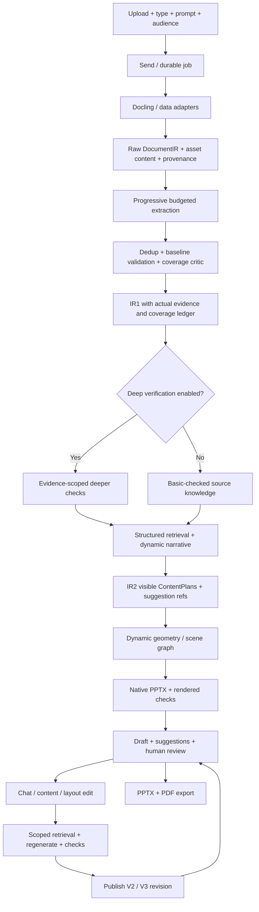

# Workflow cross-check against the preserved base plan

The user’s list is preserved below. Its two items numbered 23 are identified as **23a** and **23b**; no requirement was dropped. Current status refers to source/audit evidence, not planned module completion.

## Requirement traceability

| User point | Requirement | Current state | Module ownership | Verification / plan adjustment |
|---|---|---|---|---|
| 1 | Upload documents and file-type dropdown | Partial parser; UI missing | [F02](modules/F02_uploads_and_docling_routing.md) | Use Auto-detect by default; validate dropdown overrides; confirmed MVP format matrix. |
| 2 | User prompt | Missing for initial generation | [F03](modules/F03_prompt_enhancement_and_audience.md) | Original/enhanced prompt and controls compile into a versioned brief. |
| 3 | Send button | UI missing | [F01](modules/F01_api_jobs_and_service.md), [F02](modules/F02_uploads_and_docling_routing.md), [F03](modules/F03_prompt_enhancement_and_audience.md) | Validate inputs, persist job, and start pipeline; keep structured stage errors. |
| 4 | Parsing | Exists; routing incomplete | [F02](modules/F02_uploads_and_docling_routing.md) | Retain source bytes and parse coverage; per-file failures remain visible. |
| 5 | Docling | Exists | [F02](modules/F02_uploads_and_docling_routing.md) | Extend the current wrapper; no new independent parser pipeline. |
| 6 | Images, tables, charts, formulas | Partial | [R02](modules/R02_provenance_and_assets_repair.md), [F04](modules/F04_multimodal_asset_content.md), [F14](modules/F14_native_diagrams.md) | Preserve source data/representations and interpret contextual findings; keep chart-picture meaning distinct from verified reconstructable numbers. Q22 is planned, not runtime evidence. |
| 7 | Create IR1 from extracted content | Partial | [F05](modules/F05_ir1_source_knowledge.md), [F12](modules/F12_hybrid_agents_and_tools.md) | Typed source knowledge, with extractor/dedup/validator/critic responsibilities. |
| 8 | Actual document references in IR1 | Partial / broken assets | [R02](modules/R02_provenance_and_assets_repair.md), [R03](modules/R03_grounding_validation_repair.md), [F05](modules/F05_ir1_source_knowledge.md) | Mandatory evidence variants for text/cells/figures/formulas; not optional source provenance. |
| 9 | Optional source verification | Profile missing | [F06](modules/F06_optional_deep_source_verification.md) | Basic citation/numeric checks always; deep claim/figure checks optional, with completeness shown. |
| 10 | Audience flag/mode | Lens partial | [F03](modules/F03_prompt_enhancement_and_audience.md), [F10](modules/F10_dynamic_narrative.md) | Collect before planning. Keep IR1 audience-independent for later audience changes. |
| 11 | Geometry for sizing | Fixed / poor fit | [R04](modules/R04_quality_gate_repair.md), [F13](modules/F13_dynamic_geometry_and_layout.md) | Source bounding boxes during parsing; slide geometry only after ContentPlan/layout intent. |
| 12 | Token limit and whether full content is sent | Estimates only | [R01](modules/R01_llm_gateway_reliability.md), [F07](modules/F07_context_budget_progressive_chunking.md) | Track retained/processed/sent content separately and budget the actual request. |
| 13 | Complete context/file within max input | No reliable policy | [F07](modules/F07_context_budget_progressive_chunking.md) | Use full context when useful and within model/provider capacity including all overhead; otherwise chunk. |
| 14 | Progressive chunking | Partial / broken merge | [F07](modules/F07_context_budget_progressive_chunking.md), [R05](modules/R05_cache_resume_revision_repair.md) | Hierarchical splitting, safe merge, references/digests, per-chunk persistence and coverage. |
| 15 | Deduplicator | Exact-ID only | [F08](modules/F08_deduplication.md) | Add semantic candidates with scoped compatibility checks; preserve aliases/evidence/conflicts. |
| 16 | Structured referenced retrieval | Partial | [F09](modules/F09_structured_retrieval.md) | Record per-object actual usage; do not equate copied planner IDs with support. |
| 17 | Asset content | Partial | [F04](modules/F04_multimodal_asset_content.md), [F09](modules/F09_structured_retrieval.md) | Q22: contextual results/findings/meaning become evidence-bound knowledge used in slide text/narrative even without rendering the asset; qualified readings stay distinct from exact numeric data. |
| 18 | IR1 to IR2 | Partial | [F10](modules/F10_dynamic_narrative.md), [F11](modules/F11_ir2_content_and_suggestions.md), [R06](modules/R06_renderer_branch_integration.md) | IR2 skeleton, ContentPlans, optional reserve, scene graph, and shared renderer adapters. |
| 19 | Token limits/chunking for IR2 | Partial | [F07](modules/F07_context_budget_progressive_chunking.md), [F09](modules/F09_structured_retrieval.md), [F11](modules/F11_ir2_content_and_suggestions.md) | Global digest budget and scoped slide/edit budgets; no full-source dumping by default. |
| 20 | Extra IR2 content for editing | Missing | [F11](modules/F11_ir2_content_and_suggestions.md) | Visible content and suggestions/reserve are separate; use source pointers and on-demand retrieval. |
| 21 | Multi-agent as in PPT | Partial | [F12](modules/F12_hybrid_agents_and_tools.md), [F08](modules/F08_deduplication.md), [F06](modules/F06_optional_deep_source_verification.md) | Match inspected reference diagrams; deterministic roles need not each invoke a separate LLM. |
| 22 | Raise internal document conflicts later | Deferred | [F20](modules/F20_cross_document_conflicts.md) | Keep schema hooks/opposed claims distinct now; dedicated detection/resolution UI deferred. |
| 23a | Draft PPT plus suggested content | Missing | [F15](modules/F15_draft_and_human_review.md), [F11](modules/F11_ir2_content_and_suggestions.md) | Show actual rendered draft with scoped document-backed alternatives and labeled gaps. |
| 23b | Human-in-loop editing after PPT | Missing UI | [F15](modules/F15_draft_and_human_review.md), [F16](modules/F16_prompt_edits_and_layout_changes.md) | Post-draft review with controls/locks; optional storyboard preview is not mandatory approval. |
| 24 | Prompt editing and regeneration | Partial CLI | [F16](modules/F16_prompt_edits_and_layout_changes.md), [R05](modules/R05_cache_resume_revision_repair.md) | Scoped content/layout edits, relevant source retrieval, checks, and atomic revision. |
| 25 | Export PPTX and PDF | PPTX partial / PDF missing | [F18](modules/F18_pptx_pdf_export.md), [R06](modules/R06_renderer_branch_integration.md) | Windows demo first; PDF is rendered from the same checked PPTX/revision. |
| 26 | Shivam/reference evaluation metrics | Partial / unreliable | [F19](modules/F19_evaluation_and_academic_study.md), [R03](modules/R03_grounding_validation_repair.md), [R04](modules/R04_quality_gate_repair.md) | Keep six core metrics and define/calibrate their mathematics; incomplete judging remains incomplete. |
| 27 | Chat-like V1/V2 history | Missing; edit log only | [F17](modules/F17_chat_and_version_history.md), [R05](modules/R05_cache_resume_revision_repair.md) | Immutable artifacts, message/result links, compare/restore, and bounded edit context. |
| 28 | Change layout while editing | Missing UI / fixed backend | [F13](modules/F13_dynamic_geometry_and_layout.md), [F16](modules/F16_prompt_edits_and_layout_changes.md) | Deterministic layout-only edits preserve factual objects/evidence; remeasure and rerender. |

## Ordered target workflow

Token budgeting, source coverage, evidence links, job state, revision history, and evaluation apply across stages. Conflict candidates remain separate; full conflict resolution is deferred.

## What changes in the base plan

- Add a format dropdown/Auto-detect and supported-format fixture contract.
- Make progressive chunking and complete-source/context accounting explicit at both IR1 and IR2 stages. Full input retention is not the same as sending all bytes/visual content in one call.
- Define an evidence-preserving near-duplicate module rather than only exact-ID merging.
- Clarify optional deep verification while keeping baseline references/units/numbers mandatory.
- Separate visible IR2 content from an editing reserve/suggestions, and show the latter beside the draft.
- Match the reference PPT’s IR1 chain and fast-edit path, including bounded scoped retries.
- Add the Mermaid/graph/Dagre/native-shape module shown in both decks.
- Make post-draft human review, chat/version history, deterministic layout-only edits, and same-revision PDF export explicit.
- Keep the six named academic metrics; expand their detailed mathematical definition/calibration in F19.

The base plan’s reliability repairs, shared gateway, source grounding, dynamic narrative/scene grammar, renderer checks, API/UI separation, and independent evaluation remain. The base is copied unchanged to BASE_PLAN.md; these modules supply the requested feature-by-feature implementation organization.

## Reference PPT cross-check

Hardik BTP slide 5 depicts structured retrieval, IR2 skeleton/SlidePlan, presentation AST, rendering/QA, and a fast edit path. Slide 9’s diagram adds extractor/deduplicator/validator/coverage critic with max-two scoped retry. Slides 10–11 add native Mermaid/Dagre diagrams and the six metrics. BTP Sem 5 corroborates these in slides 5, 7, 12, and 13.

Reference slides also discuss topic/web input and broader technologies; the confirmed first-release workflow is uploaded-source generation with labeled gaps. External research/topic-only generation is not silently enabled. Statements about existing product capabilities in those slides remain target claims until CURRENT_STATE records implementation evidence.
